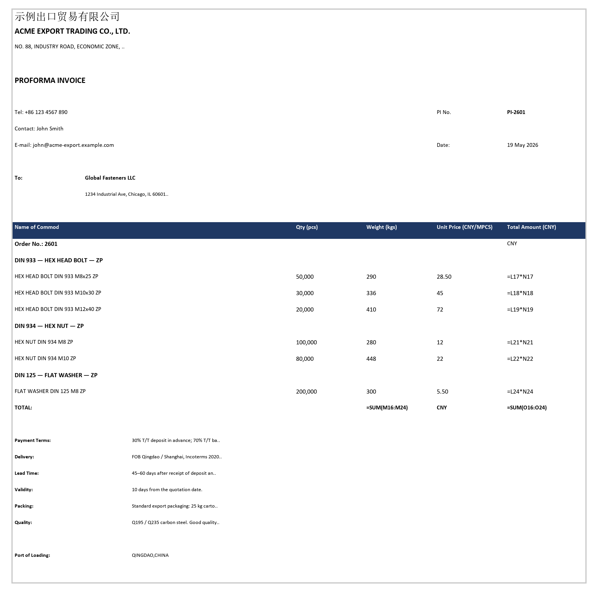

# Trade Pipeline

**Use one set of order data to prepare the trade documents you need.**

Trade Pipeline is an open-source AI skill and document engine built from day-to-day work in manufacturing exports. It helps you organize Excel requests for quotation (RFQs), prepare quotes, check order details, and generate proforma invoices (PI), commercial invoices (CI), and packing lists (PL).

[中文](README_CN.md) | **English** | [Русский](README_RU.md) | [Technical documentation (Chinese)](README_DEV.md)

[Quick start](#quick-start) · [Document examples](#document-examples) · [Release notes](https://github.com/Dangooy/trade-pipeline-skill/releases)

## Why it exists

A buyer sends an RFQ in Excel. You copy the products, specifications, and quantities into a quotation. Once the price is agreed, the same details go into the PI. At shipment, you need a CI and PL that reflect what actually shipped. One changed price, quantity, or delivery term can send you back through several files.

Trade Pipeline keeps reusable details in a structured order record and applies business rules when generating documents. You decide what to check, produce, and approve.

## What it does

| Task | What Trade Pipeline helps you do |
|---|---|
| Organize a buyer's RFQ | Extract products, specifications, and quantities from Excel |
| Prepare a quotation | Generate an Excel pricing sheet with amount formulas |
| Update prices | Match filled prices to the original order lines, even if rows were reordered |
| Prepare a PI | Use the order, prices, and verified trade terms |
| Prepare a CI or PL | Use the applicable commercial details and shipment or packing records |

WorkBuddy 1.6.4 can review material in chat or prepare any combination of PI, CI, and PL. You can request a CI or PL directly. If information is missing, WorkBuddy can prepare internal drafts and flag what remains to be confirmed.

## Document examples

These four existing screenshots show sample layouts. Check the documents and their business inputs before issuing them.

### Quotation


### Proforma invoice



### Commercial invoice


### Packing list


## Quick start

### Codex, Google Antigravity, and Claude Code

The repository contains `trade-pipeline-init` for company and customer setup and `trade-pipeline-run` for document preparation and price write-back. These skills use the repository engine and its own setup.

The engine declares Python 3.11+ as its minimum. Python 3.12 is recommended for a fresh setup.

```bash
git clone https://github.com/Dangooy/trade-pipeline-skill.git
cd trade-pipeline-skill
python3 -m venv .venv
source .venv/bin/activate
python -m pip install -e .
```

On Windows PowerShell, use `py -3.12 -m venv .venv` and `.\.venv\Scripts\Activate.ps1` to create and activate the environment.

| Client | Where to load the skills |
|---|---|
| Codex | Copy the two folders from `.claude/skills/` to the workspace's `.agents/skills/` |
| Google Antigravity | Use `.agents/skills/` in the workspace. See the [official skill guide](https://antigravity.google/docs/skills) |
| Claude Code | Open the cloned repository and use its existing `.claude/skills/` directory |

For direct or scripted use, run `python -m trade_pipeline --help`. See the [technical documentation](README_DEV.md) for an example command, configuration, and test instructions.

### WorkBuddy

> WorkBuddy 1.6.4 is pending marketplace publication. The 1.6.4 workflow below applies once that version is available there.

In WorkBuddy, open the Skill Marketplace, search for **外贸单证管线** (Trade Document Pipeline), and install the skill. Check the version shown in the marketplace. Choose the skill in a new chat.

Try **“Show me a sample quotation.”** WorkBuddy can open a fictional Excel quotation without Python or company setup. To work on your own documents, provide a quotation, purchase order, or shipment record and ask for a review or the documents you need.

> Prepare a proforma invoice and a packing list draft from these files. Flag anything that still needs my confirmation.

In WorkBuddy 1.6.4:

1. **Use this order's documents first.** The skill reads the available company, customer, and trade information and records where it came from. You can start before configuring your company or customer.
2. **Draft with what is available.** Missing fields are flagged for confirmation. Amounts affected by an unresolved calculation are flagged for review. Actual shipped quantities, weights, and carton counts need shipment or packing evidence.
3. **Confirm previously saved information before use.** Prior settings are candidates. If applicable sources conflict and the choice affects the result, choose a source or defer the field and continue with the rest.
4. **Save only on request.** WorkBuddy updates the confirmed details you ask to reuse and keeps a backup.

Excel links appear first, followed by a consolidated list of outstanding items. Before final issuance, review the parties, terms, quantities, and amounts, then confirm in the desktop dialog yourself.

Generating Excel from your own documents requires a Python 3.11+ interpreter available to WorkBuddy. The skill uses a separate environment with its bundled dependencies.

## How it stays consistent

The repository engine stores structured order data in `OrderModel`. WorkBuddy keeps a shared order record for its own on-demand drafting workflow. Each uses explicit business rules for calculations.

An early version wrote quotation prices back by row number. When a customer inserted headings or moved items, the price could end up on the wrong product. The quotation now carries a hidden UUID on each item row, allowing a price to follow the item when the UUID is preserved.

AI helps interpret the task and organize the inputs. The document engine applies the calculation rules, and the person handling the order checks trade terms and shipment figures before issuance.

## Industry and ERP scope

The project grew out of hardware and fastener exports, including DIN, ISO, and GOST parts and pricing by piece, thousand pieces, or weight. Other industries may need different templates, pricing rules, or product mappings.

Trade Pipeline supports document work alongside an ERP. Inventory, accounting, tax, and customs filing stay in their respective systems.

## Verification and data handling

- **Local tests.** 439 automated tests passed, including on-demand document combinations and A4 layout fixes for long product descriptions and identifiers.
- **Mac WorkBuddy 5.11.3.** Two fresh chats with fictional data verified clickable PI/PL drafts, selection of a price basis, and deferring a disputed amount while continuing the packing list. Consolidation after separate runs was verified in an isolated environment.
- **Coverage.** The marketplace upgrade path for the final package, Windows WorkBuddy, and equivalent end-to-end interactions on other AI clients remain untested.

The standalone CLI uses local rule-based parsing by default. Enabling `--use-llm` sends relevant RFQ content to the Anthropic API or a configured compatible endpoint. In AI clients, attachment and model data handling depend on the platform and settings.

## About the author

I’m **杨天机 (Yang Tian · Ethan Yang)**. I work in foreign trade at a manufacturing business and am learning to take over the factory. I built Trade Pipeline because I was spending hours re-entering the same order details. The price write-back issue is one of the real errors that shaped the project.

**天机，可以泄露。**

[GitHub profile](https://github.com/Dangooy) · [Tianji Skills](https://github.com/Dangooy/tianji-skills) · [Report an issue](https://github.com/Dangooy/trade-pipeline-skill/issues) · [Changelog](CHANGELOG.md) · [MIT License](LICENSE)
