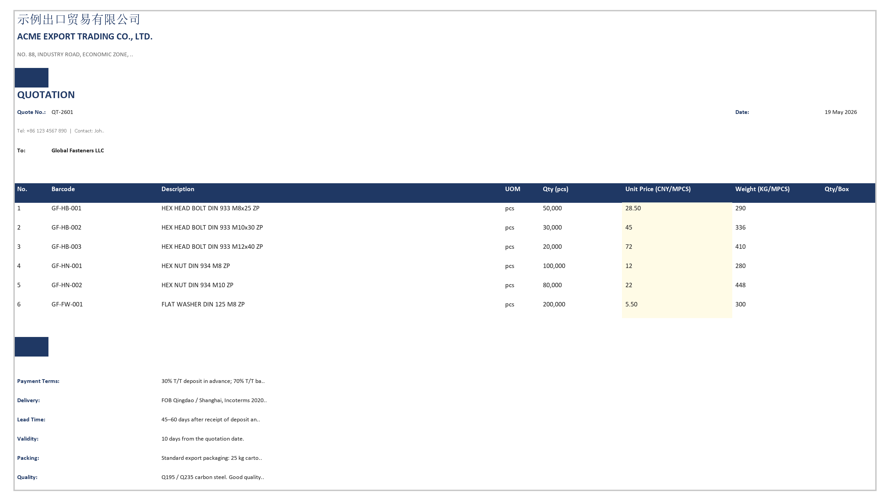
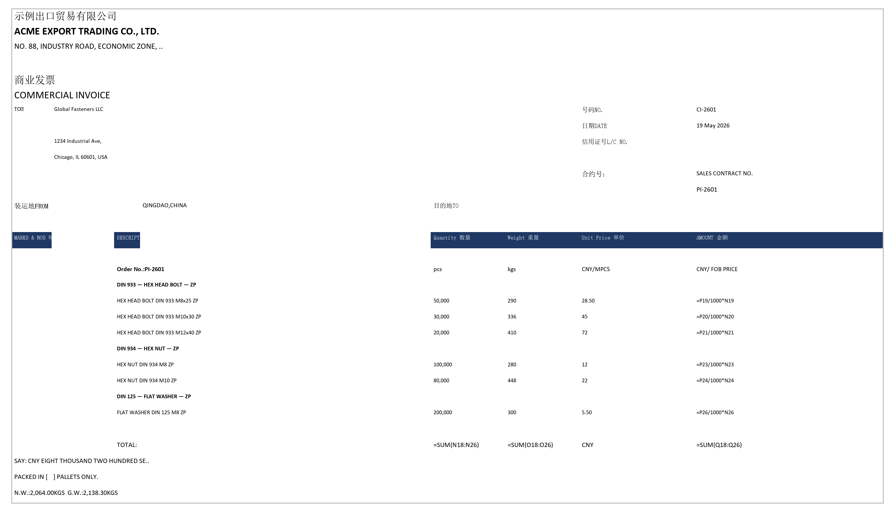
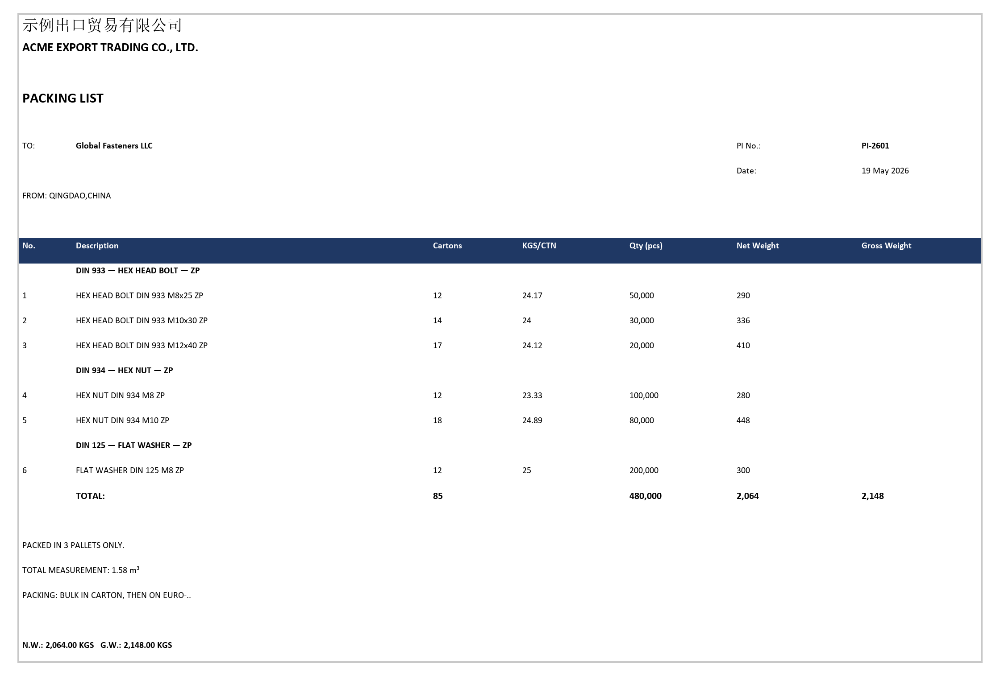

# Trade Pipeline · 外贸单证管线

[](https://github.com/Dangooy/trade-pipeline-skill/actions/workflows/ci.yml)
[](LICENSE)
[](README_DEV.md#运行测试)
[](https://github.com/Dangooy/trade-pipeline-skill/releases/latest)

[](#repository-skills)
[](#repository-skills)
[](#repository-skills)
[](#workbuddy)

**一份订单数据，按需制作外贸单据。**

减少重复录入，降低 Excel 单据之间复制粘贴和数据不一致的风险。

**中文** | [English](README_EN.md) | [Русский](README_RU.md) | [技术文档](README_DEV.md)

Trade Pipeline 是一款从真实制造业外贸工作中发展出来的**开源 AI 技能与单证工具**。

它帮助外贸业务员整理询价、制作报价单、核对订单资料，以及生成形式发票（PI）、商业发票（CI）和装箱单（PL）。

你可以通过自然语言告诉 AI 想完成什么任务，由技能结合订单资料、业务规则和单证引擎完成相应工作。

业务员负责确认交易条件，技能负责整理、计算和生成单据。

项目提供适用于 Codex、谷歌反重力（Google Antigravity）、Claude Code 的仓库技能、独立命令行工具和 WorkBuddy 市场版。各入口的安装方式和验证范围见下文。

**[快速开始](#快速开始)** · **[查看单据效果](#单据效果预览)** · **[版本记录](https://github.com/Dangooy/trade-pipeline-skill/releases)** · **[技术文档](README_DEV.md)**

---

## 为什么做这个工具？

如果你是一名外贸业务员，这些场景应该并不陌生：

- 客户发来 Excel 询价单，需要把产品名称、规格和数量重新整理到自己的报价表中。
- 客户确认价格后，又要把相同的数据填写到形式发票（PI）。
- 货物准备出运时，还要根据实际出货情况制作商业发票（CI）和装箱单（PL）。
- 客户修改了数量、价格或交易条件，需要逐份检查和修改相关文件。
- 最担心的是复制粘贴时出现错行、漏项，或者报价单、发票和装箱单中的数据对不上。

这些工作并不一定复杂，但需要反复处理，而且容易出错。

**Trade Pipeline 的解决思路是：同一笔订单尽量共用一份业务数据，根据实际需要生成和更新单据。**

不必每制作一份文件就重新整理一次订单，也不必让所有业务都按照固定顺序执行。

## 它能帮你做什么？

| 业务任务 | 主要能力 |
|---|---|
| 整理客户询价 | 提取 Excel 中的商品、规格、数量等信息 |
| 制作报价单 | 输出 Excel 报价单，填写价格并计算金额 |
| 价格回写 | 将报价单价格对应回订单数据，减少行序变化造成的错位 |
| 形式发票 PI | 根据订单、价格及交易资料生成 |
| 商业发票 CI | 根据适用的商业及实际出货资料生成 |
| 装箱单 PL | 整理实际出货数量、箱数、重量及包装明细 |
| 订单数据复用 | 共享结构化订单模型，减少不同单据的重复处理 |

**在 WorkBuddy 1.6.4 发行版中**，还可以直接核对资料而不生成文件，或者按需制作 PI、CI、PL 中的任意一种或组合。

例如，已有报价单和实际出货资料时，可以直接要求制作 CI 和 PL，不必先生成 PI。

如果资料不完整，可以先制作内部工作稿，缺少的内容留待确认。

> WorkBuddy 1.6.4 的验收范围见下文。其他客户端按各自的仓库技能说明使用。

## 单据效果预览

以下为项目提供的 Excel 单据样例。

### 报价单 · Quotation

整理商品名称、规格、数量和报价信息。黄色单价格可供业务员填写，金额通过 Excel 公式计算。



### 形式发票 · Proforma Invoice

展示交易双方、商品明细、价格、付款条件及其他交易信息。


### 商业发票 · Commercial Invoice

整理商业发票所需的商品、金额、装运及相关信息。



### 装箱单 · Packing List

整理实际出货商品、数量、箱数、净重、毛重及包装信息。



以上为既有模板的示例截图。正式出单须核对本单所用的交易和出货资料。

---

## 快速开始

Trade Pipeline 可以通过不同方式使用。

| 使用入口 | 使用方式 |
|---|---|
| **Codex** | 加载仓库技能，在 Agent 工作区中处理业务任务 |
| **谷歌反重力（Google Antigravity）** | 加载仓库技能，结合文件与 Agent 工作流使用 |
| **Claude Code** | 在克隆的仓库中使用已有的 `.claude/skills/` |
| **WorkBuddy** | 从技能市场安装独立发行版，在桌面对话中处理单据 |
| **Python 命令行** | 直接运行单证引擎，适合开发、集成与自动化 |

<a name="repository-skills"></a>

### 方式一：在 Codex、谷歌反重力（Google Antigravity）或 Claude Code 中使用

仓库提供两个 AI 技能：

| Skill | 作用 |
|---|---|
| `trade-pipeline-init` | 配置公司、客户和交易条款等基础资料 |
| `trade-pipeline-run` | 处理询价、生成单据及价格回写 |

仓库技能和独立命令行沿用下面的安装与配置步骤。

**第 1 步：安装核心引擎**

准备 Git 和 Python。

项目元数据声明最低 Python 3.11，现有仓库文档推荐 Python 3.12。首次安装建议选择 Python 3.12。

```bash
git clone https://github.com/Dangooy/trade-pipeline-skill.git
cd trade-pipeline-skill
```

Mac / Linux：

```bash
python3 -m venv .venv
source .venv/bin/activate
pip install -e .
```

Windows PowerShell：

```powershell
py -m venv .venv
.\.venv\Scripts\Activate.ps1
pip install -e .
```

**第 2 步：加载仓库技能**

| 客户端 | 加载方式 |
|---|---|
| Codex | 将 `.claude/skills/` 下的两个技能目录复制到工作区 `.agents/skills/` |
| Google Antigravity | 将技能目录加载到工作区 `.agents/skills/`，参考[官方技能文档](https://antigravity.google/docs/skills) |
| Claude Code | 在克隆的仓库中启动，使用已有的 `.claude/skills/` |

**第 3 步：直接描述业务任务**

例如：

> 初始化配置。

> 把 examples/sample_inquiry.xlsx 转成报价单。

> 客户已经确认价格，帮我回写价格并生成相关单据。

仓库技能会结合已配置的业务信息调用底层单证引擎。首次使用建议先运行仓库中的虚构示例，检查结果后再处理实际订单。

其他支持相应技能格式的 Agent 可以参考仓库技能进行适配，但各客户端的加载规则和运行效果仍需单独验证。

<a name="workbuddy"></a>

### 方式二：在 WorkBuddy 中使用

> WorkBuddy 1.6.4 尚未上架。以下 1.6.4 用法在技能市场更新后适用。

如果你希望通过 AI 对话直接处理外贸单证，可以选择 WorkBuddy 发行版本。

**安装方法**

1. 打开 WorkBuddy，进入技能市场。
2. 搜索 **「外贸单证管线」**。
3. 选择技能并安装，查看商店实际显示的版本。
4. 新建对话，选择「外贸单证管线」开始使用。

建议通过技能市场安装，以便获取平台提供的技能介绍和版本更新。

**第一次试用**

直接发送：

> 我想看一张示例报价单。

技能会提供一份使用虚构业务数据制作的 Excel 报价单。

你可以打开文件，在黄色单价格中填写测试价格，查看金额计算效果。

试用内置示例无需事先配置公司信息、运行 Python 或手动安装依赖。

**处理自己的业务**

上传报价单、采购单或出货资料，然后直接说出需求。

例如：

> 检查一下这份报价单，告诉我还缺什么信息。

> 根据这份报价单做一份形式发票工作稿。

> 根据报价单和实际出货资料，做商业发票和装箱单。

> 帮我一次制作 PI、CI 和 PL，缺少的资料列出来，不要猜测数据。

**WorkBuddy 1.6.4 的主要工作方式**

- **当前订单优先：** 从本单附件读取适用的公司、客户、贸易条款等信息，并记录来源。
- **无需强制初始化：** 不必先填写完整的 `config.yaml` 才能开始处理任务。
- **按需生成单据：** 可以只核对资料，也可以制作 PI、CI、PL 中的任意一种或组合。
- **缺项暂留待确认：** 缺少资料时先完成可完成的内部工作稿，无法确定的金额标记为「待核算」。
- **谨慎复用历史配置：** 旧资料确认适用于本单后才采用，用户明确要求时才增量保存已确认的信息，并保留备份。
- **冲突由用户决定：** 两份适用资料存在影响结果的真实冲突时，可以选择依据，也可以暂缓冲突部分，先处理其他内容。
- **正式出单由本人确认：** 正式件需满足相应出单条件，并由用户在桌面核对确认。

对于 CI、PL，实际出货数量、重量及箱数必须有相应的出货或包装依据，不能直接将报价数量当作实发数量。

处理真实资料并生成 Excel 时，WorkBuddy 需要能够调用 Python 3.11 或更新版本。技能使用独立运行环境和随包依赖，无需用户提前打开终端初始化或手动安装依赖。

**验证说明：** WorkBuddy 1.6.4 的相关交互已在 Mac WorkBuddy 5.11.3 的验收包中使用虚构资料测试。Windows 客户端尚未实测，详见下方验证范围。

### 方式三：直接使用 Python 命令行

如果需要将工具集成进自己的自动化流程，也可以直接调用单证引擎。

查看命令行帮助：

```bash
python -m trade_pipeline --help
```

根据虚构询价数据生成报价单的具体参数，以及订单模型、价格回写和其他操作，请参考 [README_DEV.md](README_DEV.md)。

---

## 它是怎样工作的？

Trade Pipeline 并不只是让 AI 把几份 Excel 模板填写完整。

在真实外贸工作中，许多错误来自不同文件的信息不一致、重复录入、错误的计价依据，以及没有确认就被填入的资料。

项目围绕这些问题采用了一些设计。

### 1. 一笔订单，共享业务数据

仓库引擎以 `OrderModel` 管理订单，并由相应的生成器制作报价单、PI、CI 和 PL。WorkBuddy 的按需做单使用自己的共享订单档案。

这样可以减少每份单据从头整理资料、独立计算造成的差异。

在支持按需更新的工作流程中，订单内容发生变化后，只重新生成受影响的单据，并保留原有文件。

### 2. AI 理解任务，程序负责关键计算

AI 适合帮助理解自然语言、识别复杂资料、组织工作步骤。

但单价、数量、金额和重量等关键数据，不应仅由语言模型生成看起来合理的答案。

项目使用明确的业务规则、确定性计算及 Excel 生成程序处理关键字段。

### 3. 不确定的信息要明确标记

缺少的交易资料不能随意补齐，存在冲突的信息不能未经确认就采用。

不同入口采用不同处理方式。

例如，独立命令行在客户匹配失败时可以生成待确认数据；WorkBuddy 1.6.4 则支持在内部工作稿中标记「待确认」「待核算」，并在必要时让用户选择依据。

### 4. 重要业务决定仍由人负责

生成 Excel 文件与确认正式交易文件，是两个不同的步骤。

尤其是商业发票、装箱单等涉及实际出货的文件，需要核对真实的数量、重量和包装依据。

WorkBuddy 1.6.4 在正式出单前增加了业务信息展示和本人桌面确认流程。

对于其他运行入口，也应在对外发送前完成必要的人工核对。

### 5. 从真实错误中改进系统

早期版本的价格回写依赖 Excel 行号。

例如，报价单第 3 行的单价，会被对应回写到订单的第 3 行。

这看起来很直接，但客户可能在 Excel 中插入分组标题、调整商品顺序。一旦行序发生变化，价格就可能对应到错误的商品。

后来，项目改为给商品行添加隐藏的 UUID 标识，让价格与商品通过独立标识对应，而不是仅依赖行号。

这个改进来自真实业务中遇到的错误，也反映了项目的设计思路：

**不仅要让工具能够完成任务，还要考虑现实中用户会怎样修改文件、哪些地方容易出错。**

更多架构、技术决策与测试方法，参阅 [README_DEV.md](README_DEV.md)。

---

## 适合什么行业？

Trade Pipeline 最初是为制造业外贸开发的，尤其关注五金、紧固件及标准件业务。

目前的业务规则和单据模板主要围绕以下场景积累：

- 垫圈、螺栓、螺母等五金及紧固件产品。
- DIN、ISO、GOST 等标准件规格。
- 按件、按千件或按重量等方式报价。
- 需要核对数量、重量、包装及出货信息的出口订单。

如果你主要依靠 Excel、邮件和即时通信工具处理客户询价、订单和出货单据，可以先使用脱敏样例试用。

其他行业也可以参考或改造，但不代表开箱即可适用。

服装尺码矩阵、电子元器件 BOM、大宗商品定价等业务，可能需要重新适配产品识别、计价规则和单据模板。

### 与 ERP 是什么关系？

**Trade Pipeline 不是 ERP 替代品。**

ERP 负责库存、采购、生产、财务、税务等企业管理流程。

Trade Pipeline 主要关注外贸业务资料与单据处理，可以作为现有流程的辅助工具。

它不负责企业级库存管理、财务记账或多人协作，也不直接向海关申报。

---

## 版本与验证范围

项目持续更新，具体版本变更请查看 [GitHub Releases](https://github.com/Dangooy/trade-pipeline-skill/releases) 和 [CHANGELOG.md](CHANGELOG.md)。

截至 2026 年 11 月 25 日的 1.6.4 发布准备记录：

| 验证项目 | 结果 |
|---|---|
| 本地自动化测试 | 439 项通过 |
| PI、CI、PL 按需组合及 A4 打印修复 | 已完成回归验证 |
| Mac WorkBuddy 5.11.3 | 使用虚构资料完成两个独立会话验收 |
| 分次生成单据后集中交付 | 已完成隔离环境验证 |
| WorkBuddy 正式安装包 | 与验收包功能文件一致，已完成本地核验 |
| 正式安装包以商店更新方式重新验收 | 尚未完成 |
| Windows WorkBuddy 客户端 | 尚未实测 |
| 其他 Agent 的同等新版交互流程 | 尚未逐一实测 |

处理实际业务前，建议先使用脱敏文件验证格式、计算结果和业务流程。

### 你的业务数据在哪里？

数据处理方式取决于使用入口。

**独立命令行**

默认使用本地解析模式，公司配置、订单模型和输出文件由本地程序管理。

可选的 `--use-llm` 云端解析功能默认关闭。主动启用后，相关询价内容会发送至 Anthropic API 或配置的兼容服务进行解析。

**AI 对话客户端**

WorkBuddy、Codex、Claude Code 等客户端中，文件读取、模型调用和数据处理取决于所使用的平台、模型及相关设置。

处理敏感客户信息、报价和收款信息前，请了解所使用平台的数据处理方式，并做好文件备份。

---

## 这个工具是怎么做出来的？

我不是专业程序员，而是一名制造业工厂的外贸业务人员，也是一名正在学习经营企业的工厂接班人。

最初开发这个工具的原因很简单：

**每周花几个小时手动整理外贸单据，做烦了。**

客户发来的 Excel 格式各不相同。报价时整理一次，客户确认后再整理一次，到了出货阶段还要继续修改相关文件。

我希望 AI 能帮我解决这些问题，于是开始使用 AI 编码工具，把自己在外贸工作中积累的经验变成可以运行的程序。

在开发过程中，我逐渐发现，困难的并不只是如何生成一张漂亮的 Excel 表格，而是如何处理真实业务中的各种例外。

客户可能修改商品顺序；两份资料中的付款条件可能不同；报价数量与实际出货数量也可能存在差异。

这些情况很难靠一份固定模板解决。

例如，早期价格回写遇到 Excel 行序变化的问题时，我与 AI 反复讨论，最终采用 UUID 隐藏标识，使商品与价格不再简单依赖行号对应。

这让我越来越认识到：**AI 能帮助实现方案，但真正理解业务问题、判断结果是否可靠，仍然需要人的经验。**

最初，我希望 AI 能替我执行一整套固定流程。

现在，我更希望它先理解用户真正想完成什么，再决定需要哪些操作。

有时候只是核对一份资料，不需要生成新的文件；有时候资料不完整，也可以先完成有依据的部分，再请用户确认。

这也是 Trade Pipeline 持续迭代的方向。

## 关于作者

我是 **杨天机（Yang Tian · Ethan Yang）**。

一名制造业外贸从业者、工厂接班人，也是一名 AI 工作流实践者。

我关注如何将真实工作和生活中的经验、判断与方法，转化成可以重复使用的 AI 能力。

我会持续分享实践过程、遇到的问题、解决方案，以及从中沉淀出来的开源工具。

**天机，可以泄露。**

- [GitHub 主页](https://github.com/Dangooy)
- [Tianji Skills：更多外贸 AI 技能](https://github.com/Dangooy/tianji-skills)

---

## 项目资源

- [技术文档](README_DEV.md)
- [版本记录](CHANGELOG.md)
- [GitHub Releases](https://github.com/Dangooy/trade-pipeline-skill/releases)
- [问题反馈](https://github.com/Dangooy/trade-pipeline-skill/issues)

欢迎使用、研究、修改和反馈。提交问题时请尽量提供可复现步骤和脱敏样例，不要公开真实客户信息、银行资料或其他敏感业务文件。

## 开源许可证

本项目采用 [MIT License](LICENSE)。

欢迎在许可证允许的范围内使用、修改和再分发。
