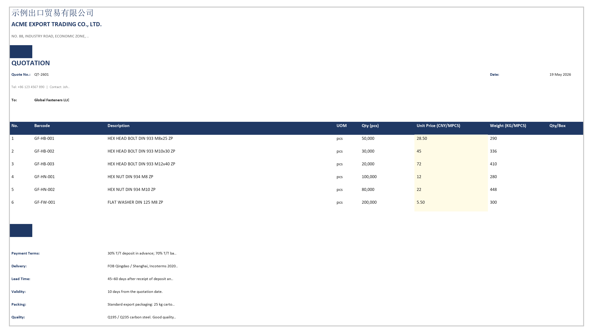
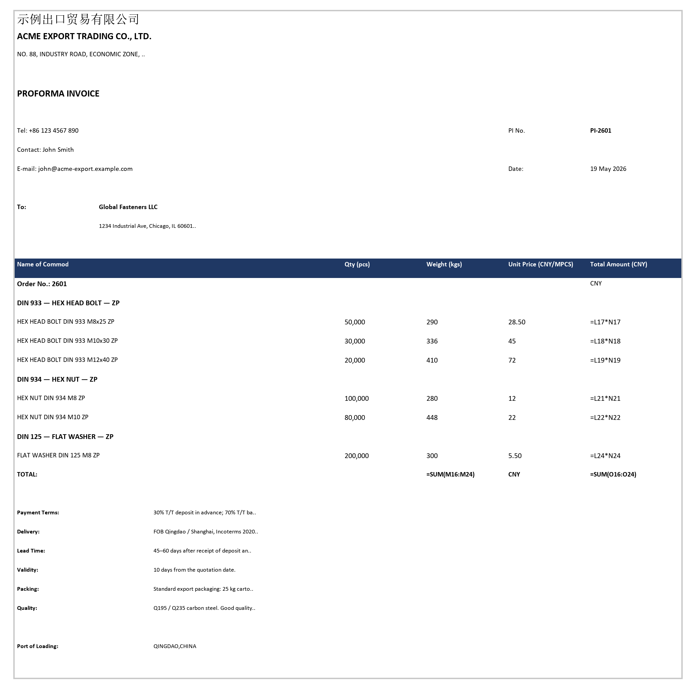
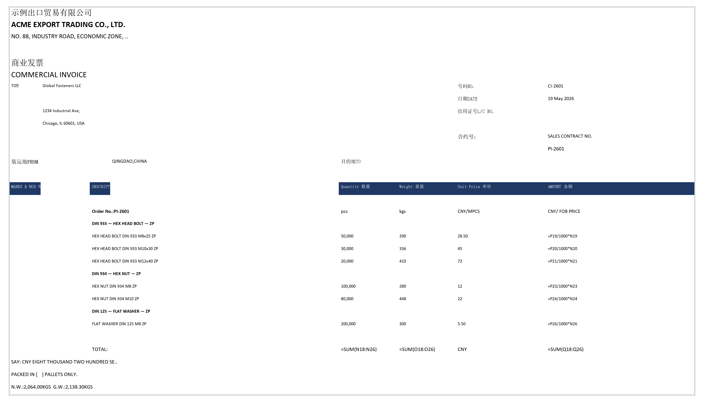
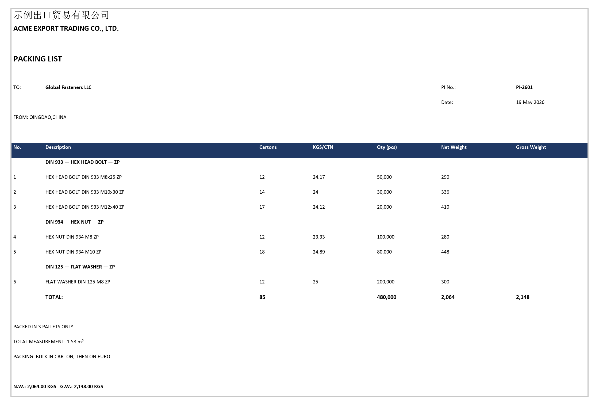

# Trade Pipeline

**Один набор данных заказа для подготовки нужных внешнеторговых документов.**

Trade Pipeline — открытый ИИ-навык и инструмент подготовки документов, созданный на основе повседневной работы в производственном экспорте. Он помогает разобрать запрос на цену в Excel, подготовить коммерческое предложение, проверить данные заказа и сформировать счёт-проформу (PI), коммерческий инвойс (CI) и упаковочный лист (PL).

[中文](README_CN.md) | [English](README.md) | **Русский** | [Техническая документация на китайском](README_DEV.md)

[Быстрый старт](#быстрый-старт) · [Примеры документов](#примеры-документов) · [Выпуски](https://github.com/Dangooy/trade-pipeline-skill/releases)

## Зачем нужен Trade Pipeline

Покупатель присылает запрос в Excel. Наименования, характеристики и количество приходится переносить в коммерческое предложение. После согласования цены те же сведения нужны для счёта-проформы, а перед отгрузкой — для коммерческого инвойса и упаковочного листа. При изменении цены, количества или срока поставки приходится проверять сразу несколько файлов.

Trade Pipeline хранит общие сведения в структурированной записи заказа и применяет бизнес-правила при подготовке документов. Какие данные проверить, какие документы выпустить и что подтвердить, решает сотрудник.

## Основные возможности

| Задача | Что помогает сделать Trade Pipeline |
|---|---|
| Обработать запрос покупателя | Извлечь из Excel наименования, характеристики и количество |
| Подготовить коммерческое предложение | Создать таблицу Excel с формулами для расчёта сумм |
| Перенести согласованные цены | Сопоставить цены с позициями заказа после перестановки строк |
| Подготовить счёт-проформу | Использовать данные заказа, цены и проверенные условия сделки |
| Подготовить CI или PL | Использовать применимые коммерческие сведения и данные отгрузки или упаковки |

В WorkBuddy 1.6.4 можно проверить материалы в чате либо подготовить PI, CI и PL в любой нужной комбинации. CI и PL можно запросить сразу. Если сведений недостаточно, система готовит внутренние черновики и отмечает, что требуется уточнить.

## Примеры документов

Четыре снимка показывают существующие шаблоны. Перед выпуском проверьте исходные сведения и сам документ.

### Коммерческое предложение



### Счёт-проформа



### Коммерческий инвойс



### Упаковочный лист



## Быстрый старт

### Codex, Google Antigravity и Claude Code

В репозитории есть два навыка. `trade-pipeline-init` настраивает сведения о компании и клиентах, а `trade-pipeline-run` готовит документы и переносит цены. Для этих навыков используется движок из репозитория со своей процедурой настройки.

Минимальная заявленная версия — Python 3.11. Для первой установки рекомендуется Python 3.12.

```bash
git clone https://github.com/Dangooy/trade-pipeline-skill.git
cd trade-pipeline-skill
python3 -m venv .venv
source .venv/bin/activate
python -m pip install -e .
```

В Windows PowerShell создайте и активируйте среду командами `py -3.12 -m venv .venv` и `.\.venv\Scripts\Activate.ps1`.

| Клиент | Где загрузить навыки |
|---|---|
| Codex | Скопируйте оба каталога из `.claude/skills/` в `.agents/skills/` рабочего пространства |
| Google Antigravity | Используйте `.agents/skills/` рабочего пространства. См. [официальное руководство](https://antigravity.google/docs/skills) |
| Claude Code | Откройте клонированный репозиторий и используйте существующий каталог `.claude/skills/` |

Для запуска из командной строки используйте `python -m trade_pipeline --help`. Пример команды, настройки и запуск тестов описаны в [технической документации](README_DEV.md).

### WorkBuddy

> WorkBuddy 1.6.4 ещё не опубликован в каталоге. Описанный ниже порядок работы доступен после выхода этой версии в каталоге.

Откройте каталог навыков WorkBuddy, найдите **外贸单证管线** (Trade Document Pipeline) и установите навык. Проверьте версию, указанную в каталоге. Затем выберите навык в новом чате.

Для знакомства можно написать **«Покажи образец коммерческого предложения»**. Навык откроет таблицу Excel с вымышленными данными. Для этого не требуется Python или настройка реквизитов компании. Для работы со своими данными приложите коммерческое предложение, заказ на закупку или сведения об отгрузке и опишите задачу.

> Подготовь черновики счёта-проформы и упаковочного листа по этим файлам. Отметь сведения, которые мне нужно уточнить.

В WorkBuddy 1.6.4 действуют следующие правила.

1. **Сначала используются документы текущего заказа.** Навык извлекает сведения о компаниях и условиях сделки, указывая источник данных. Предварительное заполнение реквизитов компании и клиента не требуется.
2. **Недостающие сведения можно уточнить позже.** Неизвестные поля отмечаются как требующие подтверждения. Если сумму пока нельзя определить, она отмечается как ожидающая расчёта. Фактически отгруженное количество, вес и число коробок требуют подтверждающих документов.
3. **Прежние настройки применяются после подтверждения.** Если два применимых источника расходятся и выбор влияет на результат, можно выбрать один источник или отложить решение и продолжить остальную работу.
4. **Сохранение выполняется по запросу.** Навык обновляет только подтверждённые сведения, которые вы хотите использовать снова, и сохраняет резервную копию.

Сначала в ответе идут ссылки на все файлы Excel, затем список вопросов. Перед выпуском проверьте стороны сделки, условия, количество и суммы, после чего подтвердите выпуск в диалоговом окне WorkBuddy.

Для создания Excel из собственных материалов WorkBuddy требуется доступ к Python 3.11 или новее. Навык использует отдельную среду с зависимостями из установочного пакета.

## Как согласуются данные документов

Движок репозитория хранит сведения в структуре `OrderModel`, а WorkBuddy использует отдельную общую запись заказа для подготовки документов по запросу. Расчёты выполняются по заданным бизнес-правилам.

В ранней версии цены переносились по номерам строк Excel. Если покупатель вставлял заголовок группы или менял порядок позиций, цена могла попасть к другому товару. Теперь у каждой позиции в коммерческом предложении есть скрытый UUID. Если идентификатор сохранён, цену можно сопоставить с нужной позицией после перестановки строк.

ИИ помогает понять запрос и собрать исходные сведения. Правила расчёта применяет программа, а условия сделки и показатели отгрузки проверяет сотрудник перед выпуском.

## Отрасли и роль ERP

Проект вырос из экспорта крепежа, метизов и других изделий по DIN, ISO и ГОСТ. В этих задачах цены могут указываться за штуку, за тысячу штук или по весу. Для других отраслей могут понадобиться свои шаблоны, правила расчёта цены и справочники товаров.

Trade Pipeline дополняет ERP при работе с документами. Учёт запасов, бухгалтерия, налоги и подача таможенных деклараций остаются в профильных системах.

## Проверка и обработка данных

- **Локальные тесты.** Пройдено 439 автоматических тестов, включая подготовку разных наборов документов и исправления печати длинных описаний и номеров на A4.
- **WorkBuddy 5.11.3 на Mac.** В двух новых чатах с вымышленными данными проверены открываемые ссылки на черновики PI и PL, выбор базы расчёта и отложенный расчёт спорной суммы. Подготовка PL продолжалась. Сводная выдача после раздельной подготовки документов проверена в изолированной среде.
- **Границы проверки.** Обновление финального пакета через каталог, WorkBuddy под Windows и эквивалентные сквозные сценарии в других ИИ-клиентах ещё не проверялись.

Командная строка по умолчанию обрабатывает данные локально по правилам. При включении `--use-llm` соответствующее содержимое запроса передаётся в Anthropic API или на настроенный совместимый сервер. В ИИ-клиентах обработка вложений и данных зависит от платформы и настроек.

## Об авторе

Меня зовут **杨天机 (Yang Tian · Ethan Yang)**. Я занимаюсь внешней торговлей на производстве и учусь управлять семейной фабрикой. Я начал этот проект, чтобы не тратить часы на повторный ввод данных заказа. Ошибка с переносом цен — один из реальных случаев, повлиявших на его устройство.

**天机，可以泄露。**

[Профиль GitHub](https://github.com/Dangooy) · [Tianji Skills](https://github.com/Dangooy/tianji-skills) · [Сообщить о проблеме](https://github.com/Dangooy/trade-pipeline-skill/issues) · [Журнал изменений](CHANGELOG.md) · [Лицензия MIT](LICENSE)
